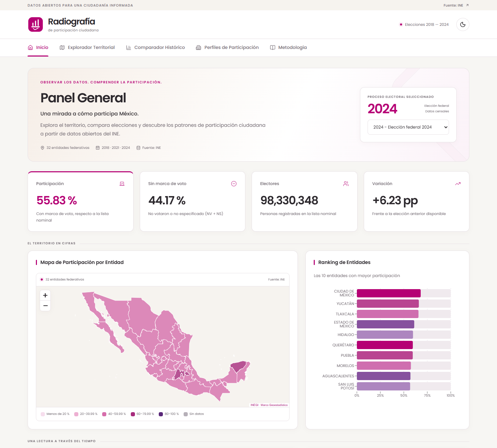
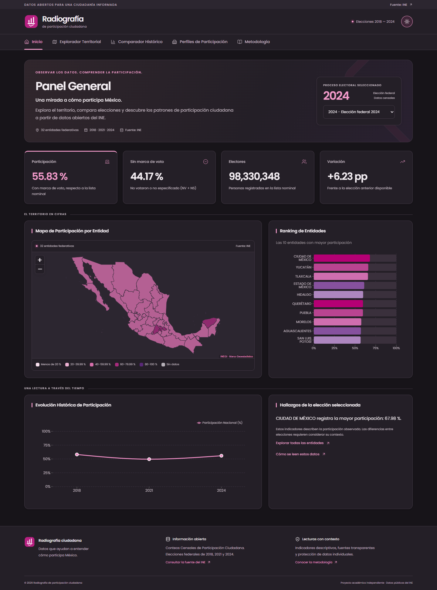

# Rediseño de la interfaz

## Referencias revisadas

- [Portal del INE](https://www.ine.mx/): cabecera sobria, fondos blancos, grises y arena, y navegación horizontal.
- [Conteos Censales de Participación Ciudadana](https://www.ine.mx/transparencia/datos-abiertos/visualizacion-datos/conteos-censales-participacion/): tipografía Poppins y acentos magenta y morado en la visualización de datos.

El diseño interpreta estas referencias para el proyecto académico. Conserva una marca propia; no reproduce el logotipo institucional del INE.

## Cambios

- Cabecera con identidad del proyecto, enlace a la fuente, periodo de datos y selector de tema.
- Navegación con estado activo, acceso por teclado y desplazamiento horizontal en móvil.
- Panel general organizado en elección, indicadores, territorio y evolución histórica.
- Cabeceras y filtros consistentes en las cinco pantallas.
- Paleta magenta/morado en las gráficas y escala secuencial con leyenda en el mapa.
- Tipografía Poppins incluida localmente con su licencia OFL; no requiere servicios externos de fuentes.
- Tema oscuro basado en grises cálidos con acentos de alto contraste.
- Ajuste del mapa al cambiar de tamaño de ventana.
- Transiciones breves en navegación, tarjetas, tema y diálogos; entrada de página de 250 ms.
- Respeto de `prefers-reduced-motion`, foco visible y enlace para saltar al contenido.

Los datos, las fórmulas, los endpoints y las funciones de análisis se conservan.

## Verificación

- Compilación de producción y análisis del código satisfactorios.
- **68 pruebas aprobadas en Chrome y 68 en Edge**, sobre la compilación de producción.
- Cinco resoluciones, las cinco pantallas, ambos temas, comparación, perfiles, mapa, fichas y manejo de errores.
- Pruebas adicionales de reducción de movimiento, navegación por teclado, contraste de la navegación y redimensionado del mapa.
- Revisión visual de capturas de escritorio, móvil y tema oscuro.

Las limitaciones previamente documentadas para Firefox y Docker permanecen: este cambio no incluye el despliegue al VPS.

## Capturas

